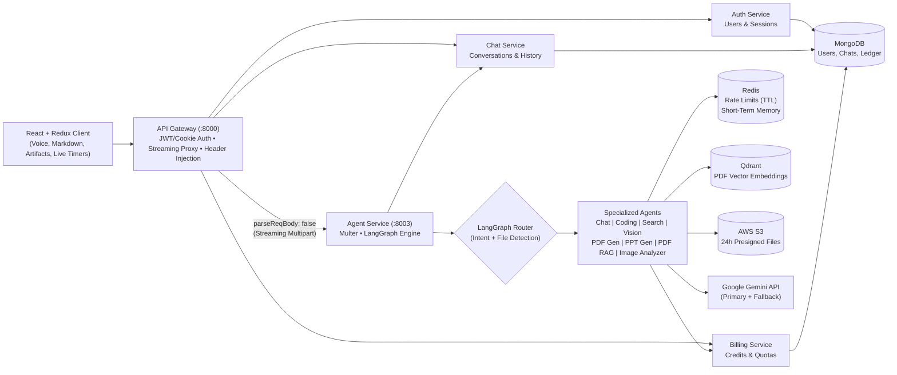

# Lumina — Distributed Multi-Agent AI Orchestration Platform


Lumina is a distributed, microservices-based AI orchestration platform built with **LangGraph**, **Node.js**, **React**, **Redis**, **Qdrant**, and **Google Gemini**. Instead of routing every prompt through a single generic LLM call, Lumina dynamically classifies user intent and uploaded media (PDFs and images) across specialized agents—complete with distributed per-agent rate limiting, credit-based billing, vector-backed RAG, ephemeral S3 document generation, and fault-tolerant model fallbacks.

🔗 **Live Demo:** `<ADD_LIVE_URL>` &nbsp;|&nbsp; 🎥 **Walkthrough Video:** `<ADD_DEMO_VIDEO_URL>`

---

## Table of Contents

1. [System Architecture](#system-architecture)
2. [Multi-Agent Capabilities](#multi-agent-capabilities)
3. [Engineering Highlights & Edge Cases Handled](#engineering-highlights--edge-cases-handled)
4. [Tech Stack](#tech-stack)
5. [Microservices & API Reference](#microservices--api-reference)
6. [Project Structure](#project-structure)
7. [Local Setup & Installation](#local-setup--installation)
8. [Design Trade-offs & Future Roadmap](#design-trade-offs--future-roadmap)

---

## System Architecture

Lumina decouples authentication, conversation persistence, billing, and AI execution into independent services behind a central API Gateway.



### Request Lifecycle
1. **Authentication & Identity Propagation:** The API Gateway validates user sessions via HTTP-only cookies and injects a trusted `x-user-id` header into downstream requests.
2. **Zero-Buffer File Streaming:** Requests to `/api/agent` bypass gateway body buffering (`parseReqBody: false`), streaming `multipart/form-data` directly to Multer in the Agent Service.
3. **Graph State & Conditional Routing:** `agent.controller.js` persists the user turn, initializes LangGraph `agentState` (`prompt`, `conversationId`, `agent`, `userId`, `file`), and invokes the router node.
4. **Quota & Rate Guardrails:** Each agent enforces per-user, per-agent Redis rate limits before making external LLM or embedding calls.
5. **Post-Execution Billing & Persistence:** Credits are deducted only after generation and S3 upload succeed; the assistant response, artifacts, and media links are saved to Redis memory and MongoDB.

---

## Multi-Agent Capabilities

| Agent Mode | Trigger / Input | Core Pipeline | Output Format |
| :--- | :--- | :--- | :--- |
| **Auto (Router)** | Default mode | Classifies prompt intent + inspects `state.file` MIME type to branch conditionally | Delegates to optimal node |
| **Chat** | Conversational prompts | Redis-backed conversation context + Gemini inference | Markdown response |
| **Coding** | Code / debugging prompts | Structured code generation + syntax-highlighted blocks | Markdown + Interactive Artifacts |
| **Web Search** | Real-time info queries | External search grounding + LLM synthesis | Cited Markdown answer |
| **PDF Generator** | Document creation prompts | Structured content generation → PDF buffer → S3 upload | 24h presigned download link |
| **PPT Generator** | Presentation prompts | Strict JSON slide schema → `pptx` buffer → S3 upload | 24h presigned `.pptx` link |
| **Vision** | Image generation prompts | Prompt-to-image pipeline + hosted media delivery | Lightbox-enabled image |
| **PDF RAG** | Uploaded `.pdf` file | `pdf-parse` → `RecursiveCharacterTextSplitter` (1000/300) → Qdrant embeddings → Top-5 similarity retrieval | Strictly context-grounded Q&A |
| **Image Analyzer** | Uploaded image (`png/jpg/webp`) | Base64 multimodal inspection + verbatim OCR + 5-part analysis expansion | Detailed Markdown / tables |

---

## Engineering Highlights & Edge Cases Handled

This section documents real production and distributed-systems edge cases encountered and resolved during development.

### 1. Gateway `413 Payload Too Large` & Multipart Boundary Corruption
* **Problem:** `express-http-proxy` buffers request bodies by default with a 1 MB `raw-body` limit, rejecting PDF/image uploads with `413` and risking multipart boundary corruption when global JSON parsers run ahead of the proxy.
* **Solution:** Configured `proxyWithHeader` to accept route-specific options and enabled `{ parseReqBody: false, limit: "20mb" }` on `/api/agent`. File streams now pipe directly to Multer on the Agent Service while preserving `proxyReqOptDecorator` for `x-user-id` injection.

### 2. LLM Demand Spikes (`503 Service Unavailable`) & Infinite UI Hangs
* **Problem:** LangChain's `ChatGoogleGenerativeAI` defaults to `maxRetries: 6` with exponential backoff. Under preview-model traffic spikes, requests silently hung for 45–60 seconds on `"Thinking..."` before failing.
* **Solution:** Set `maxRetries: 1` for fast failure and attached LangChain `.withFallbacks([fallbackModel])` in `config/llmmodel.js`, automatically failing over from `gemini-3-flash-preview` to a stable Flash/Lite model without stalling the user.

### 3. Multimodal Content-Block Schema Differences (`JSON.parse` Crashes)
* **Problem:** Newer Gemini 3 endpoints return `response.content` as an array of structured blocks (`[{ type: "text", text: "..." }]`) rather than a plain string, causing downstream `JSON.parse()` failures in structured agents like `pptAgent`.
* **Solution:** Normalized response extraction across the controller and structured agents to safely flatten both array-based content blocks and plain strings before stripping code fences and parsing JSON.

### 4. Distributed Per-Agent Rate Limiting with Live Client Countdown
* **Problem:** Expensive agents (`pdf`, `ppt`, `vision`, `search`, `coding`) have very different compute and API costs than standard `chat`. Static error strings also confuse users when reopening older conversations.
* **Solution:**
  * **Backend:** Implemented Redis `INCR` + `EXPIRE` + `TTL` keyed by `rate:{userId}:{agent}` with distinct per-minute thresholds and clamped `Math.max(1, ttl)` to avoid negative-TTL race conditions.
  * **Frontend:** Built a `RateLimitNotice` component in `MessageBubble.jsx` that computes the exact expiration timestamp from `message.createdAt`, ticks down live every second (`tabular-nums`), transitions to a ready state at `0s`, and stays accurate across page reloads.

### 5. Atomic Credit Deduction (Zero-Charge on Failure)
* **Problem:** Deducting user credits before file rendering or AWS S3 uploads meant users lost credits if PPT/PDF generation or network uploads failed mid-flight.
* **Solution:** Ordered execution strictly as `checkAgentLimit` → `LLM Inference` → `File Build & S3 Upload` → `deductCredits`, ensuring credits are only charged on verifiable delivery.

### 6. Zero-Text File Uploads & Vague Prompt Expansion
* **Problem:** Users frequently attach an image or PDF and press Enter without typing, or type single words like `"analyze"`—producing shallow 2-sentence captions and failing backend `!prompt` validation.
* **Solution:**
  * Updated controller validation to allow `prompt || file` and generate a descriptive `effectivePrompt` persisted to chat history and Redis memory.
  * Added regex-based generic-prompt expansion in `imageAnalyzer` and `pdfRag` that upgrades vague prompts into structured multi-section analysis rubrics (Overview, Breakdown, Verbatim OCR/Metrics, Technical Insights, Takeaways) while keeping specific user questions prioritized first.

### 7. Storage Hygiene & Ephemeral Asset Lifecycle
* **Problem:** Temporary Multer uploads can leak disk space on exceptions, and cloud-hosted generated files accumulate storage costs indefinitely.
* **Solution:**
  * Wrapped temporary file cleanup (`fs.unlink`) inside `finally` blocks in both `pdfRag` and `imageAnalyzer` so files are deleted whether inference succeeds or throws.
  * Enforced a 24-hour retention policy on S3/Cloudinary assets; the frontend detects expired timestamps or broken asset loads and swaps in an `ExpiredMediaCard` with a one-click **Regenerate** action referencing the prior user prompt.

### 8. Downstream Error Normalization (`Buffer` vs JSON Axios Errors)
* **Problem:** Calling `Buffer.from(error.response.data)` blindly in `catch` blocks crashed with `ERR_INVALID_ARG_TYPE` whenever billing or internal services returned standard JSON error objects instead of binary buffers.
* **Solution:** Guarded error parsing with `Buffer.isBuffer()` checks and prioritized custom rate-limit payloads (`error?.data?.message`) before falling back to Axios and generic error messages.

---

## Tech Stack

| Layer | Technologies |
| :--- | :--- |
| **Frontend** | React.js, Redux Toolkit, Tailwind CSS, `motion/react`, `react-markdown`, `remark-gfm`, `rehype-raw`, `react-syntax-highlighter`, Lucide React, Web Speech API |
| **Backend & Gateway** | Node.js (ESM), Express.js, `express-http-proxy`, Multer, Axios, Morgan, Cookie-Parser |
| **AI & RAG** | LangGraph, LangChain, `@langchain/google-genai` (Gemini 3 Flash Preview + Fallbacks), `pdf-parse`, `@langchain/textsplitters`, Qdrant Vector DB |
| **Data, Cache & Storage** | MongoDB (Mongoose), Redis (Rate Limiting & Session Memory), AWS S3 (Presigned URLs), Cloudinary |
| **Infrastructure** | Docker, AWS EC2 |

---

## Microservices & API Reference

| Service | Default Port | Responsibility | Key Routes |
| :--- | :--- | :--- | :--- |
| **API Gateway** | `8000` | Auth middleware, CORS, header forwarding, streaming proxy | `/api/me`, `/api/auth/*`, `/api/chat/*`, `/api/agent/*`, `/api/billing/*` |
| **Auth Service** | `8001` | User signup/login, Firebase/OAuth verification, JWT cookies | `POST /login`, `POST /register`, `POST /logout` |
| **Chat Service** | `8002` | Conversation CRUD, message persistence, title updates | `GET /get-conversations`, `GET /create-conversation`, `POST /save-message`, `POST /update-conversation` |
| **Agent Service** | `8003` | Multer uploads, LangGraph execution, RAG, S3 generation | `POST /chat` (JSON or `multipart/form-data`) |
| **Billing Service** | `8004` | Credit balances, per-agent deductions, usage tracking | `POST /deduct-credits`, `GET /balance` |

---

## Project Structure

```text
Lumina/
├── frontend/
│   └── src/
│       ├── components/
│       │   ├── ChatInput.jsx          # Agent selector, voice input, FormData upload
│       │   ├── MessageList.jsx        # Auto-scroll, prompt history linking, loader
│       │   ├── MessageBubble.jsx      # Markdown, syntax highlighting, lightbox, live rate-limit timer
│       │   └── LoadingAnimation.jsx   # Responsive pulse & kinetic status indicator
│       ├── features/                  # API thunks (sendMessage, createConversation, updateConversation)
│       └── redux/                     # Redux Toolkit slices (messageSlice, conversationSlice, userSlice)
└── backend/
    ├── gateway/
    │   ├── index.js                   # Route mounting & streaming proxy config
    │   ├── middleware/auth.middleware.js
    │   └── utils/proxyWithHeader.js   # x-user-id propagation + proxy option forwarding
    ├── shared/
    │   └── redis/redis.js             # Shared Redis client
    └── services/
        ├── auth/
        ├── chat/
        ├── billing/
        └── agent/
            ├── controllers/agent.controller.js
            ├── graph/
            │   ├── state.js           # LangGraph Annotation state (including file & artifacts)
            │   └── graph.js           # Conditional edges & agent node registration
            ├── config/
            │   ├── llmmodel.js        # Primary + fallback Gemini factory (maxRetries: 1)
            │   ├── agentLimit.js      # Redis per-agent rate limiter
            │   ├── vectorDb.js        # Qdrant vector store & embeddings
            │   ├── memory.js          # Redis conversational memory
            │   └── multer.js          # Multipart upload handler
            ├── agents/
            │   ├── chat.agent.js
            │   ├── coding.agent.js
            │   ├── search.agent.js
            │   ├── vision.agent.js
            │   ├── pdf.agent.js
            │   ├── ppt.agent.js
            │   ├── pdfRag.agent.js
            │   └── imageAnalyzer.agent.js
            └── utils/                 # S3 upload/presign, PPT/PDF builders, credit deduction
```

---

## Local Setup & Installation

### Prerequisites
* Node.js `v20+` (tested on `v22.17.0`)
* Docker Desktop (for Redis and Qdrant)
* MongoDB URI, Google Gemini API Key, and AWS S3 credentials

### 1. Clone the Repository
```bash
git clone [https://github.com/SandipanNayek/Lumina.git](https://github.com/SandipanNayek/Lumina.git)
cd Lumina
```

### 2. Start Redis & Qdrant via Docker
```bash
docker run -d --name lumina-redis -p 6379:6379 redis:7-alpine
docker run -d --name lumina-qdrant -p 6333:6333 qdrant/qdrant
```

### 3. Configure Environment Variables

**`backend/gateway/.env`**
```env
PORT=8000
FRONTEND_URL=http://localhost:5173
AUTH_SERVICE=http://localhost:8001
CHAT_SERVICE=http://localhost:8002
AGENT_SERVICE=http://localhost:8003
BILLING_SERVICE=http://localhost:8004
JWT_SECRET=your_jwt_secret
REDIS_URL=redis://localhost:6379
```

**`backend/services/agent/.env`**
```env
PORT=8003
CHAT_SERVICE=http://localhost:8002
BILLING_SERVICE=http://localhost:8004
GEMINI_API_KEY=your_gemini_api_key
GEMINI_MODEL=gemini-3-flash-preview
GEMINI_FALLBACK_MODEL=gemini-3.6-flash
QDRANT_URL=http://localhost:6333
REDIS_URL=redis://localhost:6379
AWS_REGION=ap-south-1
AWS_ACCESS_KEY_ID=your_access_key
AWS_SECRET_ACCESS_KEY=your_secret_key
AWS_S3_BUCKET=your_bucket_name
```

*(Configure `MONGO_URI` and `PORT` similarly in `auth`, `chat`, and `billing` services.)*

### 4. Install Dependencies & Run Services
```bash
# Install & start Gateway
cd backend/gateway && npm install && npm run dev

# Install & start Agent Service (repeat for auth, chat, billing)
cd backend/services/agent && npm install && npm run dev

# Install & start Frontend
cd frontend && npm install && npm run dev
```

---

## Design Trade-offs & Future Roadmap

* **Fixed-Window vs. Sliding-Window Rate Limiting:** Currently uses Redis `INCR` + `EXPIRE` for $O(1)$ simplicity and minimal overhead. Planned upgrade: atomic Redis Lua script implementing a sliding window log to eliminate boundary burst spikes.
* **Collection Scoping for PDF RAG:** Each uploaded PDF currently creates an isolated timestamped Qdrant collection (`pdf-{timestamp}`) to prevent cross-document leakage. Planned upgrade: store a shared collection filtered by `metadata.conversationId` + `metadata.userId` with TTL cleanup so users can ask follow-up questions about a PDF across multiple turns without re-uploading.
* **Token Streaming (SSE):** Currently returns complete agent payloads over REST to simplify post-processing of artifacts and S3 links. Planned upgrade: Server-Sent Events (SSE) for real-time token streaming on `chat` and `coding` agents.
* **Asynchronous Job Queue:** Offload heavy PDF/PPT generation and batch RAG indexing to BullMQ workers for horizontal scaling under concurrent load.

---


**Sandipan Nayek**  
B.Tech in Information Technology — Jalpaiguri Government Engineering College  
[GitHub](https://github.com/SandipanNayek) • [LinkedIn](<ADD_LINKEDIN_URL>) • [LeetCode](https://leetcode.com/u/sandipan_nayek-08/)
